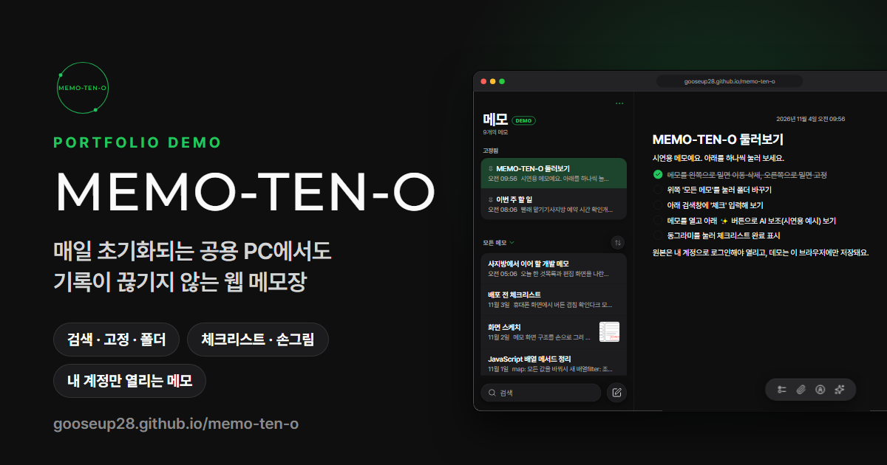

# MEMO-TEN-O 데모

군 복무 중, 매일 초기화되는 사지방(사이버지식정보방) 공용 PC에서도 기록을 잃지 않으려고 만든 웹 메모장 **MEMO-TEN-O**의 포트폴리오용 데모입니다.

**데모: https://gooseup28.github.io/memo-ten-o/**

- 빠른 기록과 검색: 새 메모는 바로 자동 저장, 제목·본문 검색, 최신순·오래된순·가나다순 정렬
- 메모 정리: 중요한 메모 고정, 폴더 분류, 목록에서 밀어서 고정·이동·삭제
- 체크리스트·손그림·사진: 동그라미 체크리스트, 직접 그리는 마크업, 사진 첨부
- 로그인과 AI 보조: 원본은 메모 주인 계정만 열리고, AI가 요약·맞춤법·문체·아이디어를 도와줌
- 그 밖에: 목록과 편집 화면을 나란히 보는 PC 화면, 휴대폰 화면, 밝게·어둡게(기기 설정 따라감), 테마 색 8가지, 백업(내보내기)

## 개선한 점

- 로그인과 보안 규칙: 원래는 로그인 없이도 메모가 열렸는데, 이제 메모 주인 계정만 읽고 쓸 수 있어요.
- 메모가 사라지던 버그 2개: 밀어서 이동·삭제를 취소했을 때, 메모를 연 채로 새 메모를 만들 때 다른 메모가 바뀌던 문제를 고쳤어요.
- 악성 코드 막기: 메모에 끼워 넣은 스크립트가 실행되지 않게 했어요.

## 데모에 대해

- 서버 없이 동작합니다. 메모는 모두 지어낸 샘플이고, 방문자 브라우저(localStorage)에만 저장됩니다.
- 처음 열면 시연용 계정(`demo@example.com` / `0000`)으로 로그인된 상태예요. 로그아웃하면 로그인 화면을 볼 수 있어요.
- AI 보조는 실제 AI를 부르지 않고, 샘플 메모용으로 미리 써 둔 **예시 결과**만 보여 줍니다.
- 사진 첨부는 인터넷에 올리지 않고, 작게 줄여서 메모 안에만 넣습니다.
- 원본 앱은 Supabase(이메일 로그인 + 메모 주인만 읽고 쓰는 보안 규칙, 실시간 동기화)와 서버 함수(Gemini, 사진 업로드)를 씁니다.

## 파일 구성

| 파일 | 역할 |
| --- | --- |
| `index.html` | PC용 소개 페이지 (PC 브라우저 창 틀 안에 앱 표시). 휴대폰에서는 `app.html`로 바로 이동 |
| `app.html` | 앱 본체 (HTML · CSS · Vanilla JS) |
| `demo.js` | Supabase 클라이언트와 같은 모양으로 동작하는 브라우저 저장소 DB + 샘플 메모 + AI 예시 결과 |
| `og-image.png` | 링크 미리보기용 대표 이미지 (1200×630) |
